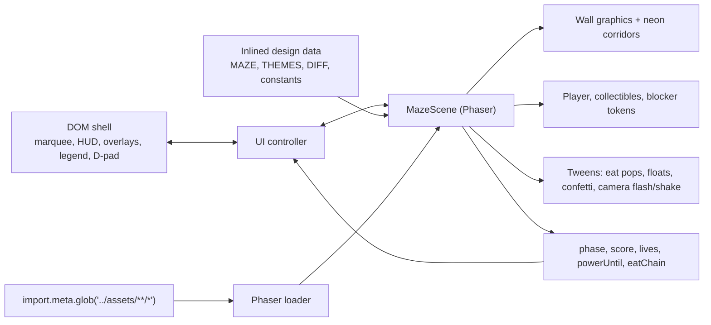

# RenderMaze Phaser Architecture

This app is a 1:1 recreation of the Claude Design `RenderMaze-Phaser.html`
prototype, ported into a Vite + Phaser project. The DOM owns the shell
(marquee, HUD, overlays, legend, controls, touch D-pad); a single Phaser scene
owns the board and gameplay.

## Why This Shape

- Phaser owns the render loop, display list, timers, tweens, and camera effects.
- The DOM owns the workshop-facing UI: HUD, title/pause/result overlays, legend,
  on-screen controls, and the touch D-pad.
- A `UI` controller class bridges the two — it reads scene state into the HUD
  and routes button/D-pad input back into the scene.

## Design Fidelity Notes

The constants come straight from the design and define the gameplay feel:

- `TILE = 32`, a 19×19 `MAZE` string grid (board is `COLS * TILE`).
- Two themes (`workshop`, `atlanta`) with their own collectibles, power pellet,
  five blockers, labels, and deck copy.
- Held-to-move: the player advances only while a key/D-pad direction is held
  (player speed `6.7` tiles/s), finishes its current tile on release, then stops.
  Instant reverse flips direction in place.
- Blockers move on a delta-driven cadence (`3.15` tiles/s normal, `1.95` when the
  player is powered) scaled by difficulty (`chill 0.82 / normal 1 / spicy 1.2`),
  with chase / patrol / wander strategies.
- Regular collectible `+10`; power pellet `+50` and `POWER_MS = 6500` of power
  mode; eat-combo `100 → 800`; eaten blockers return after
  `ENEMY_RESPAWN_MS = 3000`.
- Non-powered blocker contact costs a life and respawns; zero lives loses;
  clearing all collectibles wins.

## Asset Pipeline

Asset paths in the design (`assets/foo.svg`) are resolved through Vite's
`import.meta.glob` so they work in both `npm run dev` and the production bundle.
See the build note in the README about `assetsInlineLimit: 0`.
